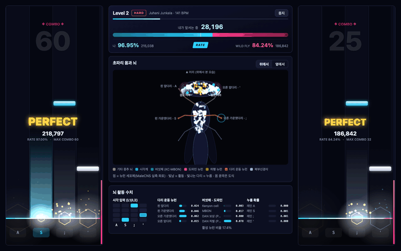

# flymax-respect-v

> 이 프로젝트는 DJMAX RESPECT V를 오마주했습니다.

**HUMAN VS FLY**: 진짜 초파리 뇌와 리듬게임으로 대결해요.



*Level 2 (HARD)에서 WILD FLY와 대결하는 모습. 가운데에서 초파리 뇌의 활동과 누르는 다리가 실시간으로 빛나요.*

실제 초파리 수컷의 중추신경계 전체 배선도(커넥톰, **MaleCNS v1.0**)로 뇌 모델을 만들었어요. 이 뇌에게 직접 만든 4레인 건반형 리듬게임을 강화학습으로 가르쳤어요. 브라우저에서 키보드로 이 초파리와 같은 곡을 동시에 치며 점수를 겨룰 수 있어요. 대결하는 동안 초파리 뇌의 어느 부분이 빛나고 어느 다리로 누르는지도 실시간으로 보여요.

> 로컬에서 실행하는 프로젝트예요. 따로 배포한 사이트는 없어요. 저장소를 받아 내 컴퓨터에서 실행하세요.

## 대결 상대

같은 게임을 세 가지 방식으로 학습시켰어요.

| 상대 | 정체 | 학습 방식 | 정확도 |
|---|---|---|---|
| **ROOKIE FLY** | 진짜 초파리 뇌 (모드 C) | 보상을 받으면 도파민 뉴런이 신호를 보내요. 이 신호로 기억 중추(버섯체)의 KC→MBON 시냅스를 **직접 고쳐 가며** 배워요. 실제 초파리가 배우는 방식이고, 역전파를 쓰지 않아요. | 69.6% |
| **WILD FLY** | 진짜 초파리 뇌 (모드 B) | 뇌 배선은 **타고난 그대로 고정**해요. 눈에 들어갈 입력과 다리 운동·하행 뉴런에서 나오는 출력을 읽는 부분만 PPO로 학습해요. | 76.0% |
| **MACHINE** | 일반 인공신경망 (모드 A) | 초파리가 아니에요. 비교 기준이 되는 MLP를 Stable-Baselines3 PPO로 학습해요. | 94.6% |

정확도는 학습에 쓰지 않은 랜덤 채보 4곡으로 잰 값이에요. 학습 전에는 두 초파리 모두 약 50%였어요. 자세한 내용은 [docs/results.md](docs/results.md)에 있어요.

## 화면 구성

- **시작 화면**: FLYMAX RESPECT V 로고가 떴다가 사라지고 로비가 나와요.
- **로비**: 곡 선택 화면이에요.
  - 왼쪽: 선택한 곡의 카드(자동 생성 커버, BPM, 난이도, 내 최고 기록), 노트 속도, 대결 상대, START 버튼
  - 오른쪽: 곡 목록(난이도별 내 등급)
- **플레이**
  - 왼쪽: 내 레일
  - 가운데: 대결 상황판(점수 차 줄다리기), 초파리 몸과 뇌(실제 뉴런 위치에서 빛나는 활동과 누르는 다리), 뇌 활동 수치
  - 오른쪽: 초파리 레일
  - 곡이 끝나면 FINISH가 뜨고 3초 뒤 결과로 넘어가요.
- **결과**: 나와 상대의 등급, 점수, 정확도, 판정별 개수, 최대 콤보를 비교하고 WIN/LOSE를 보여 줘요. 다시 하기나 로비로 갈 수 있어요.
- **Esc 메뉴**: 어느 화면에서든 Esc를 누르면 열려요. 로비, 학습, 뇌 보기로 이동할 수 있어요.
  - **학습**: 상대를 새로 학습시키고 학습 곡선을 봐요. 학습이 끝난 상대는 로비에 바로 나타나요.
  - **뇌 보기**: 시뮬레이션에 쓰는 커넥톰 정보와 ROOKIE FLY가 학습하면서 바꾼 시냅스를 분석해 보여 줘요.

### 조작

| 키 | 동작 |
|---|---|
| `A` `S` `;` `'` | 1~4번 레인 누르기 (플레이) |
| `↑` `↓` | 곡 선택 (로비) |
| `←` `→` | 난이도 (로비) |
| `Tab` | 곡 분류 (로비) |
| `[` `]` | 노트 속도 (로비) |
| `Enter` | 시작 (로비) |
| `Esc` | 메뉴 |

플레이 키는 `web/src/game/keys.ts`에서 바꿀 수 있어요. 바꿔도 초파리를 다시 학습시킬 필요는 없어요.

## 빠른 시작

필요한 것: Python 3.11 이상, Node.js 20 이상, 디스크 약 2GB, RAM 16GB 권장

### 1. 데이터 받기와 서버 설치

```bash
git clone https://github.com/anseonghyeon/flymax-respect-v.git
cd flymax-respect-v

# 커넥톰 데이터 다운로드 (약 1.1GB, SHA-256 검증)
./scripts/download_data.sh

# 서버 설치 + 커넥톰 전처리 (약 10초, 메모리 약 4.5GB 사용)
cd server
python3 -m venv .venv
.venv/bin/pip install -r requirements.lock -e ".[dev]"
.venv/bin/python -m flymax.brain.preprocess --profile compact
```

### 2. 대결 상대 학습

학습된 상대(체크포인트)는 용량 때문에 저장소에 들어 있지 않아요. **처음 한 번은 직접 학습**시켜야 로비에 상대가 나타나요.

```bash
# server 폴더에서 (시간은 Apple M4 CPU 기준)
.venv/bin/python -m flymax.train --mode A --steps 300000     # MACHINE, 약 15초
.venv/bin/python -m flymax.train --mode B --steps 1000000    # WILD FLY, 약 15분
.venv/bin/python -m flymax.train --mode C --episodes 96      # ROOKIE FLY, 약 9분
```

서버를 켠 뒤 웹 화면의 Esc 메뉴 → 학습에서 시작해도 돼요. 학습 결과는 `checkpoints/<id>/`에 `model.safetensors`와 `meta.json`으로 저장돼요.

### 3. 실행

```bash
# 터미널 1: API 서버 (127.0.0.1:8000)
cd server
.venv/bin/python -m flymax.api

# 터미널 2: 웹 화면
cd web
npm ci
npm run dev        # http://127.0.0.1:5173 접속
```

## 곡과 채보

수록곡은 Juhani Junkala의 칩튠 5곡이에요(**CC0**, [OpenGameArt](https://opengameart.org/content/5-chiptunes-action)). 곡마다 EASY, NORMAL, HARD 채보가 있어서 모두 15개예요. 출처는 [charts/audio/ATTRIBUTION.md](charts/audio/ATTRIBUTION.md)에 있어요.

채보는 음원을 분석하는 자체 생성기로 만들었어요.

- 박자(BPM), 마디의 첫 박, 킥·스네어·멜로디·하이햇 강세를 따로 분석해요.
- 소리가 실제로 두드러진 곳에만 노트를 놓아요. 조용한 구간은 성기게, 신나는 구간은 촘촘하게 배치해요.
- 레인은 이렇게 정해요.
  - 멜로디가 올라가면 오른쪽, 내려가면 왼쪽으로 한 칸씩 움직여요.
  - 비슷한 음은 트릴, 16분 연속은 계단으로 이어져요.
  - 드럼만 있는 박은 킥이 바깥 레인, 스네어가 안쪽 레인이에요.
- 같은 소리가 반복되는 마디는 같은 패턴으로 나와요. 강한 마디 첫 박에는 좌우 대칭 동시치기, 길게 끄는 음에는 롱노트를 둬요.

### 내 음원으로 채보 만들기

```bash
cd server
.venv/bin/python -m flymax.game.autochart my-song.wav --id my-song --title "My Song" \
    --artist "작곡가" --audio-out ../charts/audio/my-song.ogg
```

- WAV, OGG, FLAC 등을 읽을 수 있어요. 실행하면 `charts/my-song-{easy,normal,hard}.json` 3개가 만들어지고, 채보마다 품질 지표(강세 일치, 흐름, 연타 비율 등)를 출력해요.
- 이미 `charts/audio`에 있는 음원이면 `--audio-out` 대신 `--audio-name my-song.ogg`로 연결만 할 수 있어요.
- **저장소에는 재배포가 허용된 음원(CC0, CC BY 등)만 넣으세요.** 상용 곡이나 NCS처럼 게임에 쓰려면 라이선스가 필요한 곡은 내 컴퓨터에서만 쓰세요.

## 뇌 모델 요약

- MaleCNS v1.0에서 시각 입력(L1/L2), 다리 운동 뉴런, 하행 뉴런, 버섯체(Kenyon cell, MBON), 도파민 뉴런(PAM, PPL1)과 그 사이 회로를 골라 **뉴런 21,251개, 연결 약 25만 개**의 compact 프로필을 만들어요.
- 레이트 모델로 시뮬레이션해요. 시냅스 부호는 신경전달물질 예측(흥분성·억제성)에서 가져와요.
- 버섯체 Kenyon cell은 실제처럼 일부(약 5%)만 활성화되도록 승자독식으로 희소하게 만들어요.
- 노트는 4개 레인으로 나눈 시각 뉴런 무리에 입력되고, 다리 4개(왼쪽·오른쪽 앞다리와 가운뎃다리)의 활동이 각 레인의 누르기가 돼요.

자세한 내용은 [docs/brain-notes.md](docs/brain-notes.md)에 있고, 데이터 조사 내용은 [docs/data-notes.md](docs/data-notes.md)에 있어요.

## 프로젝트 구조

```
flymax-respect-v/
├── scripts/download_data.sh     데이터 다운로드 + 체크섬 검증
├── charts/                      채보(JSON) + audio/(CC0 음원)
├── server/flymax/
│   ├── game/                    판정 엔진(기준 구현), 채보, 채보 생성기(autochart·charter), Gymnasium 환경
│   ├── brain/                   커넥톰 전처리, 레이트 모델 시뮬레이터
│   ├── agents/                  모드 A(deep_rl) · B(mapping) · C(dopamine), 체크포인트
│   ├── api/                     FastAPI, 학습 작업 관리, 대결 WebSocket
│   └── train.py                 학습 CLI
├── web/src/
│   ├── game/                    TS 판정 엔진, 캔버스 렌더러, 사운드, 설정
│   ├── components/              상황판, 초파리 몸과 뇌, 결과, Esc 메뉴 등
│   └── pages/                   Lobby · Play · Result · Train · Brain
├── tests/fixtures/judge/        Python·TS 판정 엔진 공용 골든 테스트
└── docs/                        데이터 조사, 뇌 모델, 학습 결과
```

판정 엔진은 Python(학습·서버)과 TypeScript(브라우저) 두 가지로 구현했어요. 같은 골든 테스트로 두 엔진의 판정이 똑같은지 검증해요.

## 개발

```bash
# 서버
cd server && .venv/bin/ruff format --check . && .venv/bin/ruff check . && .venv/bin/pytest
# 웹
cd web && npm run format:check && npm run lint && npm run typecheck && npm test && npm run build
```

판정 규칙을 바꿀 때는 `server/flymax/game/engine.py`와 `web/src/game/engine.ts`를 함께 고쳐요. 그다음 `python -m flymax.game.fixtures`로 골든 테스트를 다시 만들어요.

## 보안

로컬 실행용이지만 기본값을 안전하게 두었어요.

- 서버와 웹 개발 서버는 기본적으로 `127.0.0.1`에만 열려요. 서버를 다른 주소로 열면 경고를 출력해요. 인증 기능이 없으니 외부에 노출하지 마세요.
- Host 헤더를 제한해요(DNS 리바인딩 방지). POST 요청과 WebSocket은 허용된 Origin에서만 받고, POST는 JSON만 받아요.
- 학습 요청 값(스텝 수 등)과 동시 학습·대결 수를 제한해요.
- 채보와 체크포인트는 파일 경로가 아니라 ID로만 지정해요(경로 탈출 차단).
- 체크포인트는 **safetensors + JSON**으로만 저장해요. pickle이 들어 있는 SB3 기본 `.zip`은 쓰지 않아요.
- 다른 사람이 만든 체크포인트도 열 수는 있지만, 믿을 수 있는 출처의 파일만 쓰세요.

## 출처와 라이선스

- 커넥톰 데이터: **MaleCNS v1.0**, Google Research · HHMI Janelia Research Campus. *Cell* (2026). https://male-cns.janelia.org/ · 라이선스 **CC-BY 4.0**
  - 이 저장소에는 원본 데이터가 들어 있지 않아요. `scripts/download_data.sh`로 공식 주소에서 받아요.
- 음원: Juhani Junkala, "Retro Game Music Pack" · **CC0**
- 채보, 커버 아트, 효과음은 이 프로젝트에서 직접 만들었어요. 특정 상용 리듬게임의 곡, 에셋, 디자인은 쓰지 않았어요.
- 코드 라이선스: 아직 정하지 않았어요.
